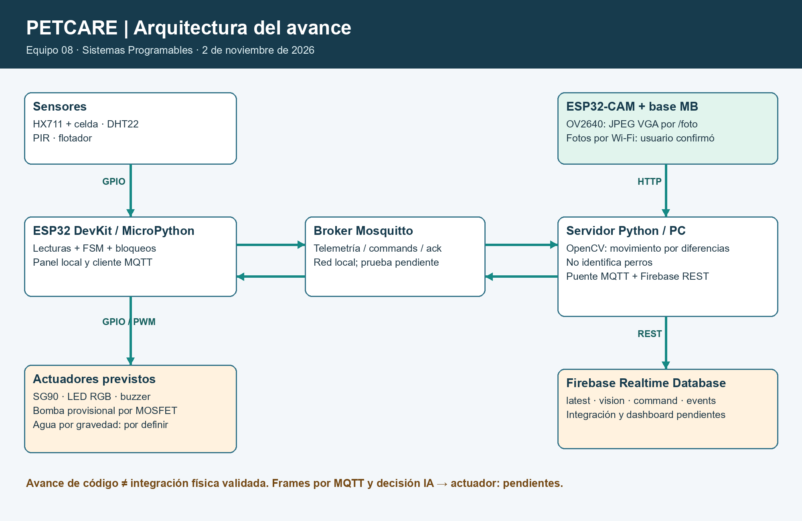
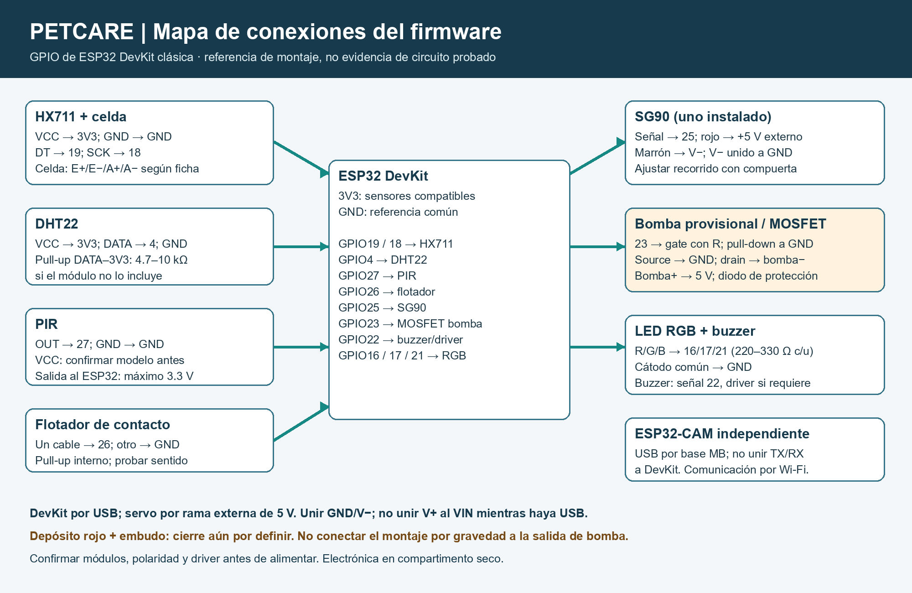

# PetCare — Estación de alimentación, hidratación y monitoreo para perros


> **Equipo:** 08, según el padrón del repositorio del curso.
> **Semestre:** ago-dic-2026
> **Materia:** Sistemas Programables — ISC TecNM León
> **Avance al 2 de noviembre:** cámara probada individualmente; integración física, MQTT y nube pendientes de validación conjunta.

| Nombre | Matrícula | Rol | GitHub |
|---|---|---|---|
| Brandon Leonel Padilla De la Cruz | 22240293 | Distribución formal por confirmar; integración del avance | [BrandonCruz09](https://github.com/BrandonCruz09) |
| Isaac Eliseo Flores Valencia | 22240324 | Distribución formal por confirmar | Pendiente |
| Lidia Verenice Padilla López | 22240312 | Distribución formal por confirmar | Pendiente |

## 📌 Descripción General

PetCare busca ayudar a quienes cuidan perros a supervisar el alimento disponible, suministrar agua de manera controlada y observar los platos desde la red local. Integra una báscula, detección de presencia y nivel, una compuerta y cámara en una carcasa económica de coroplast con compartimento seco. La automatización completa es un objetivo: este avance implementa acciones solicitadas por panel/MQTT y bloqueos básicos, no alimentación autónoma validada.

## 🏗️ Arquitectura del Sistema



La cámara es una segunda placa. La PC obtiene JPEG por HTTP; **frames directos por MQTT aún no están implementados**. El puente utiliza Firebase **Realtime Database**, no Firestore; su adecuación final a la rúbrica debe confirmarse.

### Tópicos MQTT

| Tópico | Dirección | Descripción |
|---|---|---|
| `petcare/equipo8/telemetry` | DevKit → broker → PC | JSON con peso, temperatura, humedad, presencia, nivel y estado |
| `petcare/equipo8/commands` | PC → broker → DevKit | `id` y `action`: `feed`, `water`, `stop_water` |
| `petcare/equipo8/ack` | DevKit → broker → PC | Resultado y motivo de aceptación/rechazo |
| `petcare/equipo8/vision` | PC → broker | Resultado de movimiento; no contiene la fotografía |

LED y buzzer dependen de la lógica local, sin comando MQTT propio. El circuito completo MQTT se incluye en código, todavía sin evidencia de ejecución física integral.

## 🛠️ Hardware

| # | Componente | Tipo | Cantidad | Costo MXN |
|---|---|---|---|---|
| 1 | ESP32 DevKit | Controlador | 1 | Por registrar |
| 2 | ESP32-CAM OV2640 + base ESP32CAM-MB | Cámara/controlador | 1 conjunto | Por registrar |
| 3 | Celda 5 kg + HX711 | Sensor | 1 conjunto | Por registrar |
| 4 | DHT22 | Sensor ambiente | 1 | Por registrar |
| 5 | PIR | Sensor presencia | 1 | Por registrar |
| 6 | Flotador | Sensor nivel | 1 | Por registrar |
| 7 | SG90 | Actuador compuerta | 1 instalado + 1 repuesto disponible | Por registrar |
| 8 | Bomba 5 V + MOSFET + diodo | Actuador provisional de agua | 1 conjunto en diseño anterior | Pendiente decidir cambio a válvula |
| 9 | LED RGB + 3 resistencias | Indicador | 1 conjunto | Por registrar |
| 10 | Buzzer activo/driver según consumo | Indicador audible | 1 | Por registrar |
| 11 | Fuente regulada 5 V / 5 A | Alimentación | 1 | Por registrar |
| 12 | Coroplast, soportes, jarra azul, bote rojo con embudo y platos | Estructura/depósitos | Según medidas reales | Por registrar |

No se inventan costos ni un total. La celda pesa alimento/plato, no al perro.

### Diagrama de conexiones



[Tabla HAL y conexiones del avance](hardware/HAL.md). Mapa de señales basado en el código: confirmar modelo de módulos y montaje real antes de alimentar. No es una foto de circuito validado. La plantilla vigente permite diagramas hechos en cualquier herramienta.

## 💻 Software y Firmware

La estructura es modular: `main.py` organiza; `sensores.py` lee y filtra; `controlador.py` maneja la FSM; `actuadores.py` controla salidas; `mqtt_link.py` y `wifi_panel.py` manejan comunicaciones. El HX711 promedia 3 muestras y suaviza peso con 30 % nuevo/70 % anterior; su eficacia física aún debe medirse.

### Requisitos del servidor Python

```powershell
python -m pip install -r servidor/requirements.txt
```

### Cómo ejecutar por etapas

1. **Cámara en Thonny:** usar base ESP32CAM-MB por USB de datos. Elegir MicroPython ESP32 y el puerto detectado. Requiere firmware con módulo `camera`; no sustituirlo por firmware genérico ni borrarlo sin respaldo.
2. Ejecutar `firmware/esp32cam/probar_camara.py`. Debe terminar con tres JPEG válidos y devolver `>>>`.
3. Copiar `wifi_config.example.py` como `wifi_config.py`, completar Wi-Fi 2.4 GHz local y guardar ese archivo en la **cámara**. Ejecutar `camara_wifi.py`; abrir la IP que imprime, ruta `/foto`, desde la misma red. El archivo privado está excluido de Git. No se instala automáticamente como `main.py` durante pruebas.
4. **DevKit:** conectar componentes según HAL, sin energizar mientras se cablea. Copiar los `.py` de `firmware/esp32/` a la placa. Calibrar con `calibrar_bascula.py` y completar tara/factor en `config.py`. Probar servo sin carga antes del conjunto.
5. Completar red y broker en `config.py` solo localmente; no subir claves. Si MQTT está vacío, el equipo ejecuta supervisión local. Instalar `umqtt.simple` en la DevKit para habilitar MQTT. Ejecutar `main.py`; STOP de Thonny detiene el ciclo.
6. En la PC iniciar Mosquitto configurado para la LAN. Copiar `servidor/server_config.example.json` como `server_config.json`; ajustar IP del broker y `camera_url` terminada en `/foto`. No usar `127.0.0.1` como broker desde la DevKit: allí va la IP de la PC.
7. Ejecutar `python servidor/petcare_server.py`. Firebase permanece desactivado en el ejemplo; activarlo solo después de configurar autenticación/reglas y validar localmente.

No conectar la salida de bomba al nuevo montaje por gravedad hasta elegir su actuador. La fuente externa y el USB no deben alimentar simultáneamente el mismo riel de 5 V sin aislamiento verificado.

### Librerías ESP32

| Librería | Uso |
|---|---|
| `machine`, `time`, `network`, `socket`, `dht` | Pines, tiempos, red y DHT22 de MicroPython |
| `umqtt.simple` | Cliente MQTT (instalación pendiente en DevKit física) |
| `hx711.py` incluido | Lectura de báscula |
| `camera` incluido en firmware específico | OV2640 en ESP32-CAM |

### Librerías servidor Python

| Librería | Versión declarada | Uso |
|---|---|---|
| paho-mqtt | >=2.0,<3 | MQTT |
| requests | >=2.31,<3 | HTTP cámara y Firebase REST |
| opencv-python-headless | >=4.10,<5 | Decodificación y movimiento |

### Pruebas reproducibles en PC

```powershell
python -m unittest discover -s servidor -p "test_*.py" -v
```

Son pruebas de lógica con dobles; no certifican funcionamiento físico, conexión cloud ni estabilidad de alimentación.

## 🧠 Inteligencia Artificial

- **Implementado en código:** procesamiento clásico OpenCV de imágenes consecutivas: escala de grises, reducción a 160×120, desenfoque y diferencia de píxeles.
- **Qué detecta:** cambio visual/movimiento; no identifica perros ni reconoce enfermedades.
- **Umbral inicial:** 1.8 % de imagen cambiada, ajustable; no equivale a confianza de un modelo.
- **Decisión:** publicar resultado de visión. El movimiento no dispensa automáticamente alimento.
- **Pendiente:** validación con escenas reales y definir con la profesora si necesita un modelo entrenado o una decisión IA→actuador. No hay modelo entrenado ni precisión medida.

## 🎥 Demostración

**Video YouTube:** pendiente de grabación. **Fotos de prototipo final:** pendientes; carcasa en fabricación según el equipo.
Evidencia disponible y límites: [avance del 2 de noviembre](docs/AVANCE_2026-11-02.md).

## 📋 HAL — Hardware Abstraction Layer

[Ver tabla completa: pines, tópicos, unidades, estado y dato → acción](hardware/HAL.md).
Los valores de calibración y mediciones reales están pendientes; no se presentan rangos nominales como lecturas.

## 🔥 Esquema Firebase

El puente actual usa **Realtime Database vía REST**, con autenticación anónima y token local excluido de Git:

```text
/petcare/equipo8/latest   → última telemetría
/petcare/equipo8/vision   → resultado de movimiento
/petcare/equipo8/command  → solicitud {id, action}
/petcare/equipo8/events   → eventos y confirmaciones
```

Integración, reglas por usuario y dashboard pendientes de validar. No se incluye una cuenta de servicio ni reglas públicas abiertas.

## ⚠️ Retos técnicos encontrados

1. Reinicio brownout al activar Wi-Fi; se revisó conexión USB sin desactivar protección. El usuario luego confirmó enlace de fotos funcionando; falta prueba prolongada.
2. Movimiento del SG90 depende de alimentación y fricción real. Se limita recorrido y se libera PWM en reposo; todavía falta probar la compuerta final.
3. La báscula requiere soporte rígido, tara y calibración; coroplast solo no garantiza medición estable.
4. El cambio de depósito de agua a embudo exige un cierre controlado: el firmware de bomba no resuelve por sí solo un sistema por gravedad.
5. Se corrigió identificación del repo a equipo 08. Firmware y servidor publicados usan `petcare/equipo8`; no mezclar con copias anteriores `equipo9`.

---
Avance inicial para retroalimentación. No es entrega final ni declaración de sistema completo funcionando.
