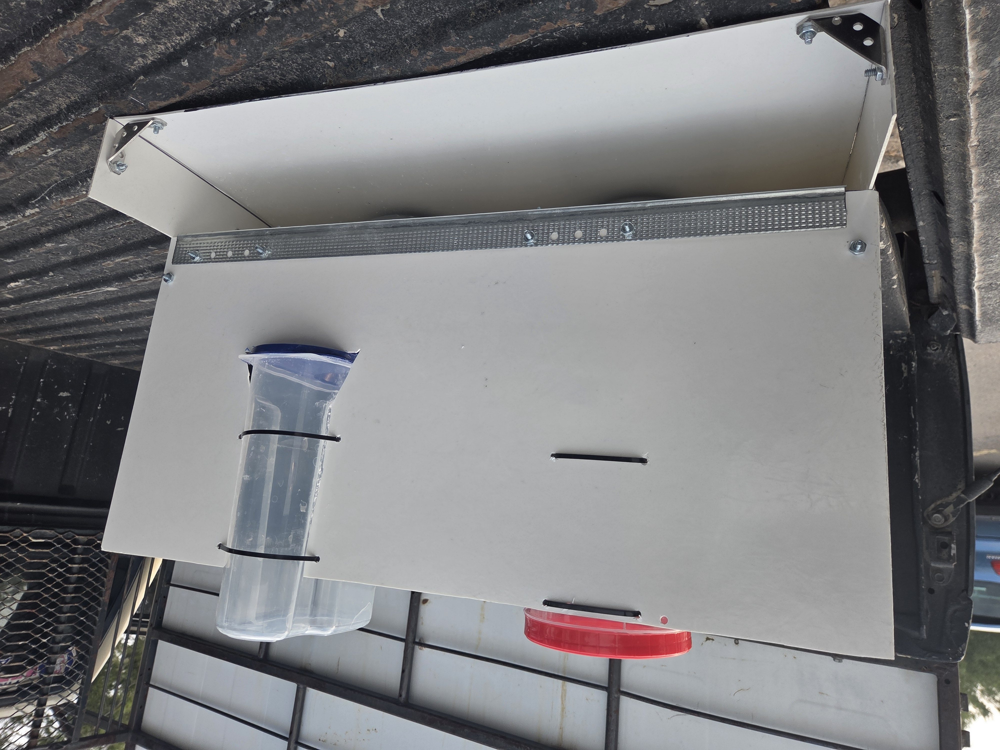
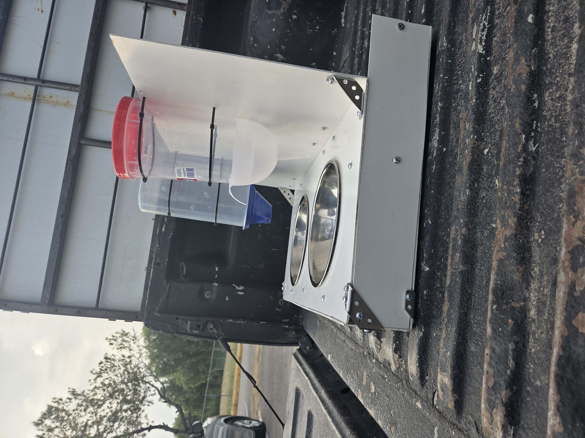

# Evidencia visual del montaje

Fotografías del prototipo físico PetCare compartidas por el equipo. Muestran la parte trasera y la vista lateral de la carcasa, depósitos y tazones. Las imágenes documentan el armado real; no son renders.

## Vistas del prototipo

### Parte trasera

### Vista lateral

## Evidencia adicional

El video de presentación está publicado en [YouTube](https://youtu.be/n1oa04Dzscc). Las fotografías restantes del conjunto se agregarán cuando estén disponibles como archivos locales para integrarlas sin alterar su contenido.
